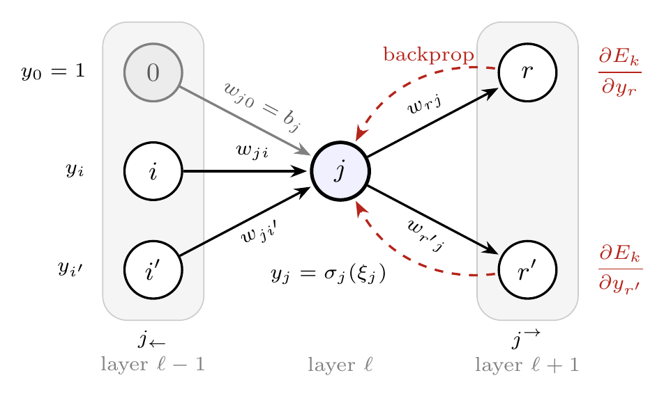

# nn-cpp



A neural network from scratch in C++, trained with backpropagation on [Fashion-MNIST](https://github.com/zalandoresearch/fashion-mnist). Derivation: [docs/backprop_derivation.pdf](docs/backprop_derivation.pdf).

## Layout

```
.
├── src/
│   ├── main.cpp    training pipeline
│   ├── io.*        data loading and export
│   ├── net.*       network
│   └── tests/      XOR check
├── docs/           derivation
├── evaluator/      accuracy script
└── data/           dataset (not tracked)
```

## Build and run

```bash
g++ -std=c++20 -O3 src/*.cpp -o network
./network
python3 evaluator/evaluate.py test_predictions.csv data/fashion_mnist_test_labels.csv
```
